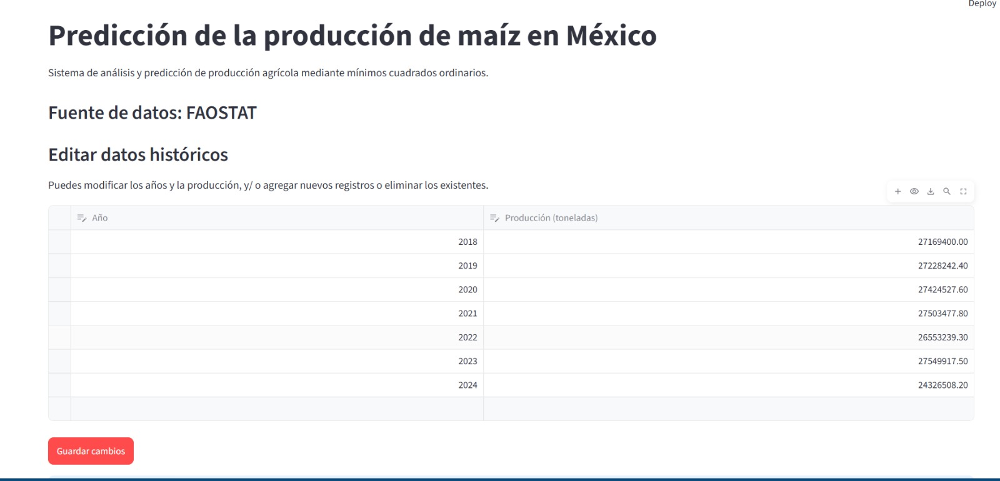
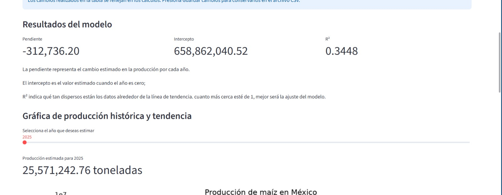
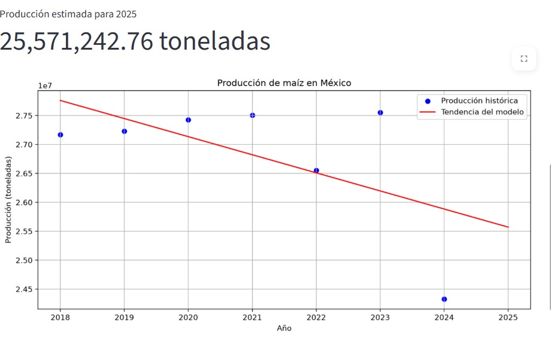
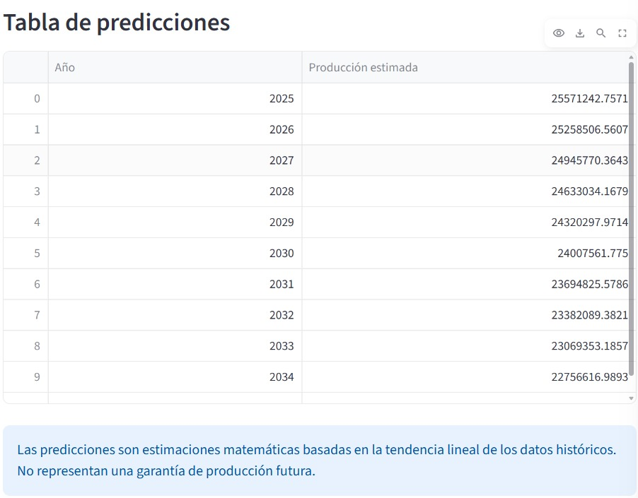

# M-nimos_Cuadrados_Producción_Ma-z
# Resumen
El proyecto consiste en la creación de una aplicación para utilizar el método de mínimos cuadrados ordinarios para analizar, actualizar y visualizar un pronóstico de la producción nacional de maíz en México a partir de datos históricos obtenidos de la FAOSTAT.

# Introducción 

# SISTEMA DE PREDICCIÓN DE LA PRODUCCIÓN DE MAÍZ EN MÉXICO MEDIANTE MÍNIMOS CUADRADOS ORDINARIOS.

Proyecto de segundo parcial.

# Integrantes: 
María Magdalena Sánchez Nicasio
Celeste Lopez Rodriguez 
Melissa Nava Jiménez

# Lenguaje: 
Python

# Interfaz: 
Streamlit

Se utilizaron diferentes bibliotecas para el procesamiento de datos, calculos matematicos y visualiación de datos.
Se implemento la interfaz de Streamlit para facilitar la cosulta de información y por que permite seleccionar un año futuro para realizar la estimación. 

# Planteamiento del problema:
El maíz es el cultivos de mayor importancia para México debido a su participación el la dieta mexicana, la economía, y la actividad agrícola del país. Sin embargo su producción es muy volátil debido a muchos factores como el clima, la disponibilidad de agua, las plagas, enfermedades y el manejo agrícola. 

Estas variaciones hacen necesario analizar los registros históricos para comprender como ha cambiado la producción a lo largo del tiempo.

Aunque exixten plataformas que proporcionan información estadística agrícola, la interpretación de los datos y la elaboración de estimaciones requieren herramientas de análisis que los pequeños productores en su mayoria no saben utilizar, y que tampoco tienen los recursos necesarios para contratar a alguien que lo haga por ellos.

Por esta razón se desarrollo la aplicación,para que los pequeños productores tengan acceso fácil y rapido a una aproximación basada en datos confiables y desarrollen una noción de tendencias de años futuros. 

# Objetivo General:
El proyecto busca demostrar como pueden aplicarse los conocimientos de programación  y estadística para analizar infromación agrícola real y generar herramientas de apoyo al estudio de tendencias productivas.

# Objetivos partciculares

1. Recopilar y organizar datos historicos de producción de maíz en México obtenidos de FAOSTAT.
2. Implementar el método de mínimos cuadrados ordinarios mediante operaciones matemáticas programadas en Python.
3. Calcular la pendiente y el intercepto de una recta de regresión lineal.
4. Evaluar el ajuste del modelo utilizando el coeficiente de determinación R2 y el error RMSE.
5. Desarrollar una interfaz interactiva mediante Streamlit. 
6. Representar gráficamente los datos históricos y la tendencia estimada.   
7. Generar estimaciones de producción para años futuros. 
8. Utilizar Gthub como herramienta de colaboración y control de versiones. 

# Solución
El funcionamiento comienza con la lectura de un archivo CSV que contiene los años y los valores de producción de maíz en toneladas. Posteriormente, el sistema utiliza estos datos para calcular los parámetros de una recta mediante mínimos cuadrados ordinarios.
Una vez obtenidos los parámetros, la aplicación permite estimar la producción correspondiente a una año seleccionado por el usuario.
Finalmente, los resultados se muestran mediante tablas, indicadores numéricos y una gráfica que representa los datos hstóricos junto con la línea de tendencia. 

La aplicación final permite editar la tabla de los datos analizados donde el productor puede registrar su producción sin importar el cultivo y realizar sus propia estimación. 

# Fuente y descripción de los datos

Los datos utilizados fueron obtenidos de FAOSTAT, la plataforma estadística de la Organización de las Naciones Unidas para la Alimentación y la Agricultura (FAO).

# Área geográfica:
México.

# Cultivo: 
Maíz.

# Dato:
Producción

# Unidad:
Toneladas

# Variable independiente (X):
Año

# Variable dependiente (Y):
Producción

El conjunto inicial contiene informacion correspondiente de 2018 a 2024.

Los datos se almacenan en el archivo data/produccion_maiz.csv, que permite que la aplicación consulte la infromación de manera organizada.

Si se incorporan nuevos registros históricos, el modelo puede recalcular sus parámetros a partir de la información actualizada.

# Metodología:
Mínimos Caudrados Ordinarios
Técnica estadística utilizada para encontrar una recta que represente la relación entre dos variables. 
En este caso, se analiza la relación entre año y producción nacional de maíz. 
La ecuación utilizada es:
Y = mX + b
Donde 
Y = producción estimada.
X = año
m = pendiente de la recta
b = intercepto

La pendiente representa el cambio estimado de producción por cada año transcurrido, mientras que el intercepto permite establecer la posición de la recta. 
El algoritmo calcula ambos parámetros mediante las formulas matematicas de mínimos cuadrados ordinarios, utilizando operaciones de NumPy en lugar de depender de una función de regresión previamente entrenada de sciki-learn.
Se utilizan dos métricas de evaluación:

Coeficiente de determinación (R2):
indica que proporción de la variación observada en los datos es explicada por el modelo lineal.
Raíz del error cuafrático medio (RMSE):
Expresa la magnitud típica de los errores de ajuste, en toneladas.Estas métricas permiten analizar el comportamiento del modelo, aunque no garantiza que las estimaciones futuras sean exactas. 

# Herramientas utilizadas:
- Python: Lenguaje principal de programación.
- Pandas: Lectura y organización de los datos históricos.
- NumPy: Operaciones matemáticas y cálculos estadísticos. 
- Matplotlib: Elaboración de gráficas. 
- Streamlit: Desarrollo de interfaz interactiva.
- Visual Studio Code: Edición y ejecución del código.
- Git y GitHub: Control de versiones y colaboración en equipo.

# Organización del código: 
El proyecto esta dividido en archivos que cumplen funciones específicas y fueron realizadas por su respectivo responsable: 

- app.py: Celeste y Melissa. Contiene la interfaz principal desarrollada en Streamlit. Carga los datos (que pueden ser editados por los propios de cada productor), presenta los resultados y permite seleccionar años futuros.
- Modelo.py: Magdalena. Contiene la implementación matematica de mínimos cuadrados ordinarios, el calculo de métricas y la función para realizar estimaciones.
- graficas.py: Celeste.Genera la representación gráfica de la produción histórica y la línea de tendencia. 
- prueba.py: Magdalena. Permite comprobar de manera independiente los cálculos y las predicciones del modelo.
- data/producción_maiz.csv: Archivo descargado por nosotras. Almacena los datos historicos de producción de maíz.  
- requirements.txt: Magdalena. Registra las bibliotecas necesarias de producción de maíz. 
- README.md: Melissa. Contiene la explicación técnica del proyecto.

# Resultados: 
- Visualización de los datos históricos de producción:

- Cálculo de la pendiente y el intercepto:
- Obtención del coeficiente R²:
- Cálculo del error RMSE:

- Representación gráfica de los registros históricos y la tendencia:

- Estimaciones de producción para los años seleccionados:

Los resultados deben interpretarse considerando que la producción agrícola está influida por diferentes factores que no forman parte del modelo.

# Conclusiones:
Desarrollar este proyecto nos permitió aplicar nuestros conocimientos de programación, estadística y análisis de datos a una situación relacionada con nuestra área de especialización de la carrera. 
Utilizar Python y Streamlit nos ayudo a integrar los cálculos en una aplicación interactiva para así facilitar la visualización e interacción para los productores.

# Concluciones particulares: 
Se utilizó Streamlit para desarrollar la interfaz de la aplicación debido a que permite integrar herramientas interactivas directamente con Python, sin necesidad de programar una página web desde cero. Se implementó st.data_editor() para que el usuario pueda modificar, agregar o eliminar registros históricos de producción de maíz, mientras que Pandas permite procesar, ordenar y validar los datos antes de utilizarlos en los cálculos. Se incorporaron validaciones para evitar años duplicados, valores negativos, registros incompletos y años no enteros, con el propósito de reducir errores en el modelo. Además, se utilizó st.cache_data para optimizar la carga del archivo CSV y un botón para guardar los cambios. Finalmente, mediante st.slider(), st.metric() y st.pyplot(), se facilita la selección de años futuros y la visualización de predicciones, indicadores estadísticos y gráficas. Estas decisiones permiten que la aplicación sea interactiva, organizada y adaptable a nuevos datos históricos.
# Como ejecutarlo:
Requisitos
Para ejecutar el proyecto se necesita:
-Python 3.
-Las bibliotecas indicadas en requirements.txt.
-Una terminal de comandos.

# Instalación:
Primero se debe descargar o clonar el repositorio desde GitHub.

Posteriormente, se debe abrir la carpeta principal del proyecto en Visual Studio Code o en una terminal.

Para instalar las bibliotecas necesarias se utiliza el siguiente comando:

python -m pip install -r requirements.txt 

# Ejecución
Para ejecutar las pruebas del modelo:

python prueba.py

Para iniciar la aplicación:

python -m streamlit run app.py

Una vez iniciado Streamlit, la aplicación puede abrirse desde la dirección local que aparece en la terminal:

# Conección entre modulos: 
app.py carga los datos del CSV, solicita los cálculos a Modelo.py, envía los resultados a Graficas.py y finalmente presenta las tablas, los indicadores y las predicciones al usuario mediante Streamlit.

# Referencias:
Organización de las Naciones Unidas para la Alimentación y la Agricultura. FAOSTAT. https://www.fao.org/faostat/

Python Software Foundation. Documentación de Python. https://docs.python.org/3/

Streamlit. Documentación oficial. https://docs.streamlit.io/

NumPy. Documentación oficial. https://numpy.org/doc/

Pandas. Documentación oficial. https://pandas.pydata.org/docs/

Matplotlib. Documentación oficial. https://matplotlib.org/stable/

GitHub. Documentación oficial. https://docs.github.com/